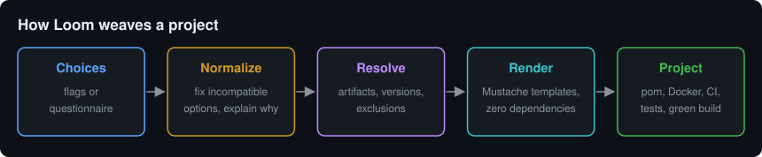

# Loom

**Weave production-grade Spring Boot projects from your terminal.**

Loom is an interactive scaffolder for the JVM: answer a questionnaire (or pass
flags), and it weaves a ready-to-import Maven project where every dependency,
version, and exclusion has been **resolved for compatibility** — not
copy-pasted from a five-year-old blog post.


<details>
<summary>Everything the questionnaire covers</summary>

```
$ ./loom

Language:            Java | Kotlin
Spring Boot line:    3.x (Jakarta) | 2.7 (legacy javax)
Web stack:           MVC | WebFlux | none
Servlet container:   Tomcat | Undertow | Jetty
HTTP client:         RestClient | WebClient | RestTemplate
Database:            PostgreSQL | MySQL | MariaDB | MongoDB | H2
Data access:         JPA | JDBC | R2DBC
Migrations:          Flyway | Liquibase
Caching:             Caffeine | Redis
Messaging:           RabbitMQ | Kafka | ActiveMQ Artemis
JSON:                Jackson | Gson
Logging:             Logback | Log4j2
Testing:             JUnit 5 | TestNG  ·  Mockito | EasyMock  ·  Testcontainers
Extras:              JaCoCo · Lombok · OpenAPI · Actuator · Docker · GitHub Actions
```

</details>

Unzip → `mvn verify` → green. That's the contract.

## Quick start

```bash
git clone <this-repo> && cd loom
./loom                      # interactive (auto-builds on first run, JDK 17+ only)
```

Or fully scripted:

```bash
./loom -y --name orders-api --db postgres --migrations flyway --tc --openapi
./loom -y --name legacy-svc --boot 2 --java 11 --db mysql --tests testng --mock easymock
./loom -y --name gateway --lang kotlin --web webflux --db postgres --cache redis --mq kafka
```

Run `./loom --help` for every flag. Prefer Maven? `mvn package` produces the
same `target/loom.jar`.

## Why not Spring Initializr?

Initializr is great — for the happy path. Loom targets the projects real
teams actually maintain:

- **The legacy line.** Spring Boot 2.7 / `javax` scaffolding with the *right*
  coordinates (old ones where the BOM still needs them, TestNG 7.5.1 and EasyMock 4.3
  on Java 8, an explicit Testcontainers BOM) — because half the industry's
  code still lives there, and migrations start with a faithful baseline.
- **Opinions Initializr won't give you.** TestNG, EasyMock, Gson, Undertow and
  Jetty wiring, Log4j2 with `spring-boot-starter-logging` excluded from
  *every* starter — done correctly, everywhere, automatically.
- **Infrastructure included.** A `docker-compose.yml` whose services,
  credentials and ports match the generated `application.yml` exactly, with
  healthchecks. `docker compose up -d && mvn spring-boot:run` just works.
- **Tests that pass on a laptop.** Testcontainers via `@ServiceConnection`
  when you opt in; otherwise SQL stacks automatically get an H2 test profile
  in the right compatibility mode so `mvn verify` is green with zero servers
  running.
- **A resolution engine, not a checkbox list.** WebFlux + Gson? Forced to
  Jackson, with an explanation. WebFlux + JPA? Warned about blocking the event
  loop, R2DBC suggested. R2DBC + Flyway or Liquibase? A JDBC bridge is configured for
  migration time. Boot 3 + Java 8? Bumped to 17. Every decision is printed.
- **CI on day zero.** A GitHub Actions workflow tuned to the generated stack.

## Design



- **Zero runtime dependencies.** The CLI, the questionnaire, the resolution engine and
  the Mustache-subset template engine are ~1,400 lines of plain JDK 17. No
  supply chain, nothing to audit, builds with `javac` alone (`./build.sh`).
- **One version catalog.** Every pinned version lives at the top of
  [`Resolver.java`](src/main/java/dev/loom/Resolver.java). Anything Spring
  manages carries no version at all — the Boot BOM stays the single source of
  truth, so generated projects age well.
- **Templates you can read.** Plain Mustache files in
  [`src/main/resources/templates/`](src/main/resources/templates). Fork the
  repo, edit a template, and Loom generates *your* company standard.

The full option matrix and every resolution rule is documented in
[docs/DECISION-TREE.md](docs/DECISION-TREE.md).

## Verifying a change

```bash
mvn verify          # unit tests: template engine, compatibility rules, resolver
./build.sh          # compile + package (javac only)
./scripts/smoke.sh  # generates 5 very different stacks and validates them
```

The smoke suite renders a modern default, a kitchen-sink enterprise stack, a
Kotlin reactive gateway, a Boot 2.7 legacy service and a minimal library, then
checks for unrendered tags, leaked nulls, and malformed XML/YAML. CI runs all
three commands.

## Roadmap

- Gradle (Kotlin DSL) output
- Entity + repository + CRUD slice generation
- CXF / SOAP client scaffolding for the enterprise integration crowd
- Spring Boot 4 line when it stabilises
- MongoDB migrations via Mongock
- `sdkman` / Homebrew distribution

## License

MIT — see [LICENSE](LICENSE).
