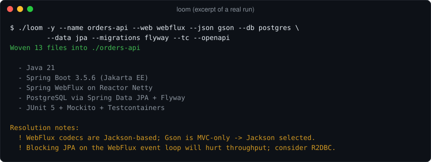
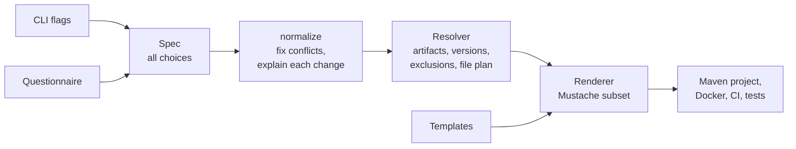

# Loom


A command line scaffolder for Spring Boot. You describe the stack, and Loom generates a
Maven project with compatible dependencies, or explains why it changed your choice.



## The problem

Most time lost on a new service isn't the code. It's the combinations that fail later:
Log4j2 with the default logging starter still in place, Gson on WebFlux, Flyway on
R2DBC with no JDBC driver, or Boot 2.7 coordinates that have since moved. Each one is
small, and each one costs an afternoon.

Loom turns those rules into code. Every rule is explicit and tested, and every change
it makes is printed, so nothing happens silently.

<details>
<summary>Everything the questionnaire covers</summary>

```
$ ./loom

Language:            Java | Kotlin
Spring Boot line:    3.x (Jakarta) | 2.7 (legacy javax)
Web stack:           MVC | WebFlux | none
Servlet container:   Tomcat | Undertow | Jetty
HTTP client:         RestClient | WebClient | RestTemplate
Database:            PostgreSQL | MySQL | MariaDB | MongoDB | H2
Data access:         JPA | JDBC | R2DBC
Migrations:          Flyway | Liquibase
Caching:             Caffeine | Redis
Messaging:           RabbitMQ | Kafka | ActiveMQ Artemis
JSON:                Jackson | Gson
Logging:             Logback | Log4j2
Testing:             JUnit 5 | TestNG  ·  Mockito | EasyMock  ·  Testcontainers
Extras:              JaCoCo · Lombok · OpenAPI · Actuator · Docker · GitHub Actions
```

</details>

## Quick start

```bash
git clone <this-repo> && cd loom
./loom                      # interactive (auto-builds on first run, JDK 17+ only)
```

Or fully scripted:

```bash
./loom -y --name orders-api --db postgres --migrations flyway --tc --openapi
./loom -y --name legacy-svc --boot 2 --java 11 --db mysql --tests testng --mock easymock
./loom -y --name gateway --lang kotlin --web webflux --db postgres --cache redis --mq kafka
```

Run `./loom --help` for every flag. Prefer Maven? `mvn package` produces the
same `target/loom.jar`.

## Architecture



## Design decisions

| Decision | Why | Trade-off |
|---|---|---|
| No runtime dependencies | Nothing to audit, and it builds with `javac` alone | A small hand-written template engine |
| One version catalog | Every pinned version sits at the top of `Resolver.java` | Pins need bumping by hand |
| No version on Spring-managed artifacts | The Boot BOM stays the source of truth | Only pinned extras can drift |
| Fix and explain, rather than fail | You keep moving, and you learn why | Loom can override a choice |
| Plain templates | Fork them and Loom generates your company standard | Maven only for now |

The full matrix is in [docs/DECISION-TREE.md](docs/DECISION-TREE.md).

## Why not Spring Initializr?

Initializr is the right tool for a standard project. Loom covers what it leaves to you:

- **The legacy line.** Spring Boot 2.7 / `javax` scaffolding with the *right*
  coordinates (old ones where the BOM still needs them, TestNG 7.5.1 and EasyMock 4.3
  on Java 8, an explicit Testcontainers BOM) — because half the industry's
  code still lives there, and migrations start with a faithful baseline.
- **Opinions Initializr won't give you.** TestNG, EasyMock, Gson, Undertow and
  Jetty wiring, Log4j2 with `spring-boot-starter-logging` excluded from
  *every* starter — done correctly, everywhere, automatically.
- **Infrastructure included.** A `docker-compose.yml` whose services,
  credentials and ports match the generated `application.yml` exactly, with
  healthchecks. `docker compose up -d && mvn spring-boot:run` just works.
- **Tests that pass on a laptop.** Testcontainers via `@ServiceConnection`
  when you opt in; otherwise SQL stacks automatically get an H2 test profile
  in the right compatibility mode so `mvn verify` is green with zero servers
  running.
- **A resolution engine, not a checkbox list.** WebFlux + Gson? Forced to
  Jackson, with an explanation. WebFlux + JPA? Warned about blocking the event
  loop, R2DBC suggested. R2DBC + Flyway or Liquibase? A JDBC bridge is configured for
  migration time. Boot 3 + Java 8? Bumped to 17. Every decision is printed.
- **CI on day zero.** A GitHub Actions workflow tuned to the generated stack.

## Testing

| Layer | What it checks | Runs in CI |
|---|---|---|
| 20 unit tests | Template engine, compatibility rules, resolver | Yes |
| Smoke suite | 5 very different stacks: no unrendered tags, no leaked nulls, valid XML and YAML | Yes |
| Generated projects | `mvn verify` passed on 12 generated stacks in October 2026 | No, run by hand |

```bash
mvn verify          # unit tests
./build.sh          # compile and package with javac only
./scripts/smoke.sh  # generate and validate 5 stacks
```

## Roadmap

- Gradle (Kotlin DSL) output
- Entity + repository + CRUD slice generation
- CXF / SOAP client scaffolding for the enterprise integration crowd
- Spring Boot 4 line when it stabilises
- MongoDB migrations via Mongock
- `sdkman` / Homebrew distribution

## License

MIT — see [LICENSE](LICENSE).
